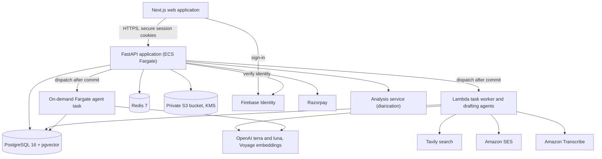

# Vivekium Engineering and System Design

**Status:** current. **Reviewed:** 2026-10-14 against the decision register, the specs it links and the module, table and test names it cites (names were checked to exist; behaviour is described from the specs and prior records, not re-run). Sections that rest on an owner decision not yet built say so.
**Authority:** the latest dated owner decisions ([../decisions/REGISTER.md](../decisions/REGISTER.md)) and the specifications in [../spec/](../spec/); code, migrations and tests are the evidence of what exists. Removed designs are in [../history/](../history/).

## 1. Purpose

How Vivekium (formerly ReadyPick) is built today: the shape of the system, the invariants that hold it together, and where each concern lives. It is a map, not a tutorial; each section links to the normative document for detail. What to change where: [../engineering/where-to-change.md](../engineering/where-to-change.md).

## 2. System context



Four authenticated workspaces (Provider, Company, Candidate, Business Development) plus public token and link workflows. Email goes through Amazon SES; SES-only (no SMTP path) is decided and pending (register I-20). What runs where: [../operations/INFRA_TOPOLOGY.md](../operations/INFRA_TOPOLOGY.md).

## 3. Technology stack

| Layer | Technology |
|---|---|
| Frontend | Next.js 16 App Router, React 18, TypeScript strict, Tailwind CSS 3, shadcn/Radix primitives, Framer Motion, Recharts, Monaco (self-hosted), Firebase client SDK, Vitest |
| API | Python 3.12, FastAPI, Pydantic v2, Gunicorn with Uvicorn workers |
| Persistence | SQLAlchemy async, asyncpg, Alembic; PostgreSQL 16 with pgvector (1024-dimension vectors) |
| Background work | `app/workers/dispatch` to AWS Lambda (seconds) and on-demand Fargate (minutes); no Celery. EventBridge Scheduler for sweeps |
| Cache and state | Redis 7 (`noeviction`): rate limits, tenant-keyed caches, run status, auth sessions, proctoring counters |
| Models | OpenAI `gpt-5.6-terra` (judge and write), `gpt-5.6-luna` (extract and classify), Voyage `voyage-4` (every embedding) plus a Voyage rerank model; closed mapping, no fallback chain |
| Identity | Firebase Authentication (Google, email and password) plus application-issued JWT sessions |
| Files | Private S3, content-addressed, KMS-encrypted |
| Payments | Razorpay subscriptions (monthly plans) and Orders (Starter top-up), webhooks deduplicated |
| Email | Amazon SES (platform and company senders); see section 14 |
| Speech and analysis | Amazon Transcribe for spoken answers; a separate analysis service (pyannote diarization, flagged AI-text detector) |
| Web research | Tavily |
| Containers and IaC | Docker, Docker Compose for local, Terraform in `infra/`, GitHub Actions |

## 4. Repository structure

```text
pickready/
├── backend/            FastAPI app (app/api, core, models, schemas, services, prompts, workers, evaluation, scripts), alembic/versions, tests, harness/
├── frontend/           Next.js app (app/ route groups, components, lib, public)
├── analysis-service/   proctoring analysis service: own image, tests, one secret
├── lambda/             the two zip functions: assessment_trigger, inbound_email
├── infra/              Terraform modules and environments (pilot is the live composition)
├── scripts/            test, harness, build, deploy and hygiene scripts
└── docs/               all documentation (index: docs/README.md)
```

Notable `backend/app/services/` packages: `hiring/` (Sutra, gates, runbook_data), `yukti/`, `miti/`, `siddhi/`, `assessment_pipeline/`, `assessment_conversation/`, `assessment_questions/`, `assessment_formats/`, `proctoring/`, `evidence/`, `rag/`, `tools/`, `agents/`, `projects/`, `leadership/`, `safety/`. Single-file services include `skills.py`, `assessment_contract.py`, `hiring_pipeline.py`, `credits.py`, `monthly_plans.py`, `email_outbox.py`. The resilience harness lives in `backend/harness/` and is never imported by `backend/app/`.

## 5. Architectural principles

1. **Domain services behind thin routes.** Routes validate access and transport; services own lifecycle and rules.
2. **Explicit workflow state.** Jobs, applications, invitations, assessments, pipeline moves, billing events and verifications store durable state; retries never rely on in-memory progress.
3. **Tenant isolation in depth.** Application filtering is reinforced by PostgreSQL row-level security; provider and BD bypass is explicit and audited; every cache key contains the tenant id.
4. **Capability-based authorization.** Role defaults plus per-user overlay; business routes call `require_capability`, never a role-name branch.
5. **Internal numbers, qualitative output.** Numeric values exist for computation; `services/rating.py` is the only place they become one of four words, at the serializer. No number reaches a client.
6. **Idempotent external effects.** Ledger writes, webhooks, tasks and emails use stable keys or state guards.
7. **The database is authoritative (AD-1).** An A2A artifact is a typed hand-off built from committed rows, never a store ([../spec/ARCHITECTURE.md](../spec/ARCHITECTURE.md)).
8. **A degradation is recorded, never silent.** No substitute scores; no template presented as generation.

## 6. Data architecture

Migrations: linear chain, head `0136_monthly_assessment_plans`; additive and guarded; run as a one-off job before traffic moves, never from every replica.

- **Identity and tenancy:** users and Firebase mapping, tenants (`tenants.status`: onboarding, active, prospect, archived), company profiles and departments, roles, capabilities and per-user overrides, staff invitations, sessions in Redis, append-only `audit_log`.
- **Job setup and contract:** `jobs`, `job_competencies` (the Skills store: bucket, priority, hidden evidence line, `authored_by`), `job_swot_analyses`, `job_skill_snapshots` (insert-only contract), `job_leadership_contexts`, `job_assignments`.
- **Candidates and applications:** candidates, reusable profile form, resumes, `job_candidate_links` (source, validation fields, pipeline status mirror, Yukti columns), `pipeline_status` history, interview rounds, team reviews, `candidate_updates`, conversations and messages, `candidate_projects` (derived evidence only).
- **Assessment:** `assessment_conversations` (the invitation), `candidate_questions`, `assessment_answers`, `assessment_pauses`, `voice_answers`, `video_recordings`, proctoring sessions and events, the evidence ledger (`evidence_items`, claims and links), `evaluations`, `functional_skills_reports` and `report_dimensions` (insert-only), review dispositions, `context_chunks` (retrieval index with provenance).
- **Verification:** `candidate_employments` (immutable once finalized), `bgv_inquiries`, `bgv_verifications`, `bgv_contact_corrections`, consent catalogue and events.
- **Commercial:** `credit_ledger` and lots, `credit_purchases`, `billing_transactions`, `monthly_gateway_plans`, subscription columns on `tenants`, reconciliation markers.
- **Business development:** `bd_leads` (six milestones), AI Reach runs and results, lead-to-tenant linkage.
- **Kept as history, read by no live path:** `job_swot_intakes`, `agent_learnings`, `agent_actions`, `agent_execution_traces`, `portable_evidence_items`, `jobs.level` and the seven-stage `job_competencies` columns. See [../operations/LEGACY_TABLES.md](../operations/LEGACY_TABLES.md).

## 7. Authentication and sessions

The browser signs in with Firebase (Google, or email and password) and sends the ID token to `/api/v1/auth/firebase/session`, after a server-checked CAPTCHA proof. The API verifies it, resolves the account's workspace from its own record (the sign-in form never asks; a chooser appears only when one identity holds several memberships) and issues application sessions with distinct JWT audiences for provider owner, company and candidate; BD sessions use the owner audience with no tenant context. Google never signs in a company role.

Cookies (access, refresh, session hint) are httpOnly, Secure on HTTPS, SameSite=Strict, with no Max-Age, so a session ends with the browser. The access JWT lives 15 minutes; a Redis session record enforces 30 minutes idle, moved only by real user activity. Refresh rotation is atomic; logout or password change revokes the server record; a cookie with no session id is refused. Firebase identity is held only in memory. Password reset and change are server-side behind a security code and a single-use ticket. `tenants` and `users` have forced RLS; login, refresh and workspace resolution use the documented identity-resolution bypass. Candidate identity: one person, one record, resolved by `candidates.user_id`. Rules: [../engineering/security.md](../engineering/security.md).

## 8. Authorization and database isolation

Each request resolves identity, workspace and audience, tenant context, membership, role defaults and individual overrides; the capability set is checked before the operation. A scoped capability is further constrained by `job_assignments` and, for a Functional Head, by department (`services/department_access.py`, `rbac.decide`). RLS policies read session-local variables set by the RLS-aware session. Bypass routes stay narrow, logged and covered by cross-tenant tests; a cross-tenant read is 404. The authority is [../spec/RBAC_SPECIFICATION.md](../spec/RBAC_SPECIFICATION.md); the implemented matrix is [../reference/RBAC.md](../reference/RBAC.md).

## 9. Job setup

Create Job (draft with JD), Sutra drafts Skills, the team edits and saves them, the Final Job Posting is previewed, the job publishes, and the first genuine application freezes the JD and Skills into an immutable snapshot that every candidate is assessed against. The SWOT is separate hiring intelligence. The approval flow, SWOT timing and publish rights decided on 2026-10-14 are not built. Normative: [../spec/JOB_SETUP_FLOW.md](../spec/JOB_SETUP_FLOW.md); API: [../reference/JOB_SETUP_API.md](../reference/JOB_SETUP_API.md).

Posting state is derived from publish, end and grace dates (generated columns), archive and closure; public lookup returns nothing after the window; application editing honours the five-day grace. Closing a job withholds then purges its assessment data after 30 days.

## 10. Candidate intake, files and parsing

An application creates or links the candidate record and snapshots the reusable profile and resume onto the job-candidate link; it writes no assessment. Resumes (PDF and DOCX) are content-addressed in S3, served only through authenticated routes, previewed as sanitized HTML. Bulk databank ingestion accepts up to 25 files with per-file results and enters candidates at `sourced`. Resume parsing is dispatched after commit and survives an embedding outage (text committed, vector backfilled). Project Evidence Intelligence turns optional submissions into derived evidence and deletes the originals ([../spec/PROJECT_EVIDENCE_INTELLIGENCE.md](../spec/PROJECT_EVIDENCE_INTELLIGENCE.md)); uploads are hostile input and never executed.

## 11. Resume reading and ranking

Yukti reads each resume against the job's saved Skills on fixed parts, one model call per batch of five, returning words and verbatim quotes that code verifies against the resume; compensation never reaches the model; a failure is `not_assessed`. A databank discovery run joins consenting candidates and enters them at `sourced`. Ranking is one key derived in SQL (`yukti.ranking.rank_score_sql`): a blend of the assessment and Yukti's reading, outermost-capped by a failed Must-have, a total order. Retrieval (pgvector and PostgreSQL full text, fused by rank) selects candidates; it never decides who is read. Normative: [../spec/RETRIEVAL.md](../spec/RETRIEVAL.md). The five-part model is proposed only (S-21).

## 12. Assessment architecture

Specified in [../spec/ASSESSMENT_FLOW.md](../spec/ASSESSMENT_FLOW.md); summary of the structure:

- **Invitation.** One writer (`services/assessment_invitations.invite_batch`), a batch checked for credit once, an email drafted by a worker after commit.
- **Questions.** `services/assessment_questions`: one per skill, never below the grade floor; mix by largest remainder; written per candidate from the bound snapshot with their rubric by Vaada; formats in [../spec/ASSESSMENT_QUESTION_FORMATS.md](../spec/ASSESSMENT_QUESTION_FORMATS.md).
- **Conversation.** `services/assessment_conversation`: server-held turn clock and pauses, `turn_seq` on every answer, spoken answers by Transcribe, a mandatory proctoring gate ([../spec/PROCTORING.md](../spec/PROCTORING.md)). Proctoring inference runs in the browser; the server decides every threshold and imports nothing a scorer reads.
- **Recording.** Segments, a stored purge date, access for the job's hiring team only.
- **Scoring.** `functional_assessment.run_assessment` orchestrates four stages in `services/assessment_pipeline`: load evidence, Miti grades (sole authority), Siddhi composes (withholds uncited statements), persist an insert-only report. One run per application, serialized by an advisory lock.
- **Coding.** Today the code can run candidate code in a sandbox, switched off. **Decided, pending (S-20):** no sandbox; a static checker and AI review ([../spec/CODING_ASSESSMENT.md](../spec/CODING_ASSESSMENT.md)).
- **Report.** `services/prism_view` is the one serializer for screen and PDF; the PDF leaves through gate G4 and the candidate's retention consent.
- **Agents and gates.** Bodha (SWOT), Sutra (Skills), Yukti, Vaada, Miti, Siddhi; gates G1 (a locked, adequate contract), G2 and G3 (loud, non-blocking), G4 (a recorded human decision). Evaluator isolation is a field set, the aggregator calls no model, citation enforcement has no bypass ([../engineering/ai-runtime.md](../engineering/ai-runtime.md)).

## 13. Hiring pipeline

Server-validated graph with append-only history and a current-state mirror, written only by `hiring_pipeline.apply_transition` (and `start_sourced` for a link created at `sourced`):

```text
sourced -> applied
applied -> assessment_invited | shortlisted
assessment_invited -> assessment_in_progress | assessment_completed   (system only)
assessment_in_progress -> assessment_completed                        (system only)
assessment_completed -> shortlisted
shortlisted -> interview_scheduled | offer_extended
interview_scheduled -> interview_completed
interview_completed -> interview_scheduled | offer_extended
offer_extended -> joined
non-terminal -> hold | rejected
```

The offer gate (a declared employer must be verified by a person before an offer) sits in `apply_transition`; rejection is never blocked. Every transition writes a candidate Update from a fixed catalogue.

## 14. Communications and verification

One writer of candidate email (`email_outbox.queue_candidate_email`) resolves the sender (a named active company sender, else the tenant default, else the platform mailbox), claims the row before sending, and is idempotent per stage. Content is AI-drafted with a deterministic fallback and editable where composition is offered. Today the transport is `email_transport` = `smtp` or `ses` (the pilot runs SES). **Decided, pending (I-20):** Amazon SES only, platform mail from `contact@readypick.ai`, company-sender mail unchanged. Security codes always come from the platform sender.

Background verification: the candidate's employment history is submitted once and immutable; each hiring tenant runs its own verifications; a request carries a reply address; a person marks the result. Inbound reply threading is inert on pilot. Candidate chat is native: written to Postgres first and announced second, the socket accepts no write frame.

## 15. Billing

Four monthly plans through Razorpay subscriptions, a Starter-only top-up through Orders, an append-only credit ledger in integer sub-units (60 per credit) with idempotency keys, lots that roll over three months, GST invoices. Gates ask `services/entitlements.py`. Demonstration tenants are exempt from refusals, never from records. Register C-01 to C-07; code `services/monthly_plans.py`, `credit_packs.py`, `credits.py`.

## 16. Business development

Leads share one model with six milestone timestamps; marking an agreement signed creates a prospect tenant once; un-signing archives it; AI Reach runs in two independent modes and reports `ok`, `unconfigured`, `timeout` or `unavailable` with word confidence.

## 17. AI model router

`services/llm_router.invoke_llm(task_type, ...)` is the only path to a model; `config/llm_providers.py` is data only and maps every task type onto exactly one of two chat models or the embedding model. Guarantees: a per-task timeout and a total wall-clock budget with a predicting deadline; bounded retries with backoff honouring `retry-after`; a circuit breaker keyed by credential fingerprint that trips on the first 401 or 403; native JSON `response_format` with a contract check; a truncated response is a failure retried once at double tokens; two interactive tiers (15s/30s and 25s/50s). Verified limits to remember: `max_tokens` is refused (use `max_completion_tokens`), `temperature` 0 is refused (a seed is sent, best effort), `voyage-context-4` does not exist (`voyage-4` at 1024 dimensions). Re-run `scripts/verify_live.py` after changing the transport, ids or credentials; evidence is in [../verification/VERIFICATION_RESULTS.md](../verification/VERIFICATION_RESULTS.md). Rules: [../engineering/backend.md](../engineering/backend.md).

## 18. API organization

Routes are grouped by domain (authentication, companies and staff, jobs, job setup and assessment under `/api/v2/assessments`, candidates and files, pipeline and emails, billing, provider, BD, public). `api/assessment_reports.py` keeps the `/api/v2/assessments` prefix because issued links are URLs. The running OpenAPI explorer is the executable route contract; the frontend's route version is the guide for new clients.

## 19. Background processing and schedules

Every task is `@task(name, route, rls)`; `Route.LAMBDA` for seconds, `Route.ECS` for minutes (scoring, question generation, recording processing). Requests dispatch with `dispatch_after_commit`. Retries live in `runtime.run_task` only. Sweeps run from EventBridge Scheduler and are mirrored in `workers/schedule.py` (a parity test compares them). Spec: [../spec/BACKGROUND_WORK.md](../spec/BACKGROUND_WORK.md).

## 20. Caching, pagination and performance

Tenant-keyed Redis caches (tool results, public jobs, dashboards), GZip above about 1 KB, a 25-row candidate page, async database access, materialized dashboard views refreshed about every five minutes, ANN indexes on embeddings. Not every list endpoint paginates identically. Debt: [../decisions/OPEN.md](../decisions/OPEN.md) Q-32.

## 21. Security and privacy

Controls are listed in [../engineering/security.md](../engineering/security.md): Firebase verification, httpOnly cookies and audience separation, capability checks, forced RLS, audited bypass, signed webhooks, tokenized public workflows, authenticated document routes, sanitized DOCX preview, compensation never reaching a model, hostile-input handling, KMS on every write, rate limits, append-only audit. Open: the retrieval injection screen is mandatory and not wired (A-20); malware scanning on upload is not deployed; tested data-subject export workflows do not exist. Secrets live in AWS Secrets Manager and developer-local files are never committed or copied into documents.

## 22. Testing and verification

About 480 backend test modules plus Vitest, the agent evaluations, the golden journey, and the resilience harness. How to run and what each rule is pinned by: [../engineering/testing.md](../engineering/testing.md). Gaps: no comprehensive browser end-to-end suite across all four workspaces, no load-test baseline, no chaos tests for Redis or object storage beyond the harness faults, no accessibility audit in CI.

## 23. Storage

One private S3 bucket per environment, default `aws:kms`, bucket policy refusing any other key; objects content-addressed by sha256; no raw bucket URL or key ever reaches a browser; durable database values are `s3://` references read through authenticated, tenant-scoped, capability-checked routes. Prefixes and lifecycle (resumes and compliance durable; `project-intake/` temporary and HEAD-verified deleted; assessment recordings segmented with a stored purge date; voice answers one day; noncurrent versions expire after a day on media prefixes): [../operations/INFRA_TOPOLOGY.md](../operations/INFRA_TOPOLOGY.md). Not deployed: malware scanning on upload.

## 24. Deployment

AWS: ALB with WAF in front of ECS Fargate services (api, frontend, analysis), on-demand Fargate tasks (agent, migrate), Lambda functions (task worker, drafting agents, the one zip trigger holding `iam:PassRole`), RDS PostgreSQL, ElastiCache, S3, Secrets Manager, EventBridge Scheduler, CloudWatch alarms, CodeBuild for native arm64 image builds. Pilot is the live site; staging and production are defined, never applied. Data subnets have no route to the internet in either direction. IAM is per service and enumerated. Procedures and the digest-verified deploy: [../operations/DEPLOY_AWS.md](../operations/DEPLOY_AWS.md), [../engineering/infrastructure.md](../engineering/infrastructure.md).

## 25. Known gaps

Everything unresolved or deliberately accepted is in [../decisions/OPEN.md](../decisions/OPEN.md); everything decided and not yet built is in the register's Pending changes.
