# Vivekium Product Requirements

**Status:** current. **Reviewed:** 2026-10-14 against the decision register, the specifications in [../spec/](../spec/) and the code names they cite. Sections marked **decided, pending** state an owner ruling that is not built yet.
**Authority:** the latest dated owner statement ([../decisions/REGISTER.md](../decisions/REGISTER.md)), then the RBAC specification and the Runbook, then [../spec/](../spec/). Where the running product differs from a specification the code shows what exists and the register's Pending changes say what is owed. Removed behaviour is recorded in [../history/](../history/).

## 1. What the product is

Vivekium (Varpitech LLP; formerly ReadyPick) is a multi-tenant hiring operations platform. One chain runs from a job draft to a joined candidate: job setup, candidate intake, resume reading, one proctored assessment, an immutable PRISM Report, pipeline communication, employer verification, billing and business development.

| Workspace | Users | Purpose |
|---|---|---|
| Provider | Vivekium owner and operators | Provision customers and BD accounts, inspect customer health, view portfolio billing; read-only over customer data |
| Company (Customer Portal) | Company staff, leadership, department heads | Jobs, candidate review, assessments, compliance, staff, billing, hiring decisions |
| Candidate | Applicants and sourced candidates | Reusable profile and resume, apply, take an invited assessment, track applications, message the company |
| Business development | Vivekium BD users | Leads, AI-assisted reach, conversion of signed prospects into customers |

The public site explains the product and shows pricing beside "Open a role". It also hosts registration, login, public job applications, outreach responses and employer pages.

## 2. Principles

1. **The job is the anchor.** Ranking, assessment content, reports and workflow actions are scoped to a job.
2. **No number reaches a client, ever.** Scores are internal; clients see words (section 10).
3. **AI assists; rules protect.** Models draft and evaluate; validation, fixed rubrics and auditable states keep work correct. A model failure is a recorded state, never a substitute score or a template presented as generation.
4. **Humans decide.** No integrity flag auto-rejects. Sensitive actions need a person at any confidence.
5. **Access is capability-based** (data, not role branches) and every tenant is isolated at the database.
6. **Candidates are assessed against a locked snapshot** of what the job required, so reports stay comparable.
7. **Billing is an append-only, idempotent ledger.**
8. **The product stores intelligence, not originals,** where it can (projects), and withholds then purges assessment data when a job closes.

## 3. Users and roles

Permissions are data in `role_permissions` plus a sparse per-user overlay; the matrix is in [../reference/RBAC.md](../reference/RBAC.md) and the authority is [../spec/RBAC_SPECIFICATION.md](../spec/RBAC_SPECIFICATION.md).

- **Provider owner.** Searches and inspects customers, edits only industry, website and notes, archives or restores a customer, views compliance documents, provisions and disables BD accounts, views portfolio billing, and may set a customer's primary contact (the one carve-out). No other write to customer data.
- **Company Super Admin** (`client`). Company-wide responsibility for jobs, profile, staff, compliance and billing. Creates leaf roles.
- **Staff, in chain of authority:** Recruitment Manager (and the older HR Manager, which ranks beside it), Recruiter, Hiring Manager. A manager controls only roles beneath their own and grants only capabilities they hold. Staff invitations use a seven-day token. At most five active Hiring Managers per company.
- **Interview Manager.** Reads a candidate's report and adds Team Review remarks; no pipeline controls, no job preparation.
- **Leadership roles** (Super Admin creates them): **CEO** and **MD** read the organisation and write only their own leadership input; a **Functional Head** is bound to one department and sees only that department's jobs, candidates and reports.
- **Candidate.** Owns one reusable profile and a main resume; applies through a public link; assessed only after an invitation.
- **Business-development user.** `manage_bd_leads`, `view_bd_customers`, `use_ai_reach`; no access to customer hiring data.

Who may do what in job preparation and publishing is **decided, pending** (J-10 to J-16): see section 6.

## 4. End-to-end journey

```mermaid
flowchart LR
    A["Company Profile"] --> B["Job: JD"]
    B --> C["Skills (Hiring Manager)"]
    C --> D["Approval and publish (decided, pending)"]
    D --> E["Applications, sourced, databank"]
    E --> F["Yukti reads resumes, one rank"]
    F --> G["Recruiter invites"]
    G --> H["Proctored assessment, graded by Miti"]
    H --> I["PRISM Report"]
    I --> J["Pipeline: interview, offer, join"]
```

## 5. Company setup

- **Company Profile.** Three sections the client authors once: About the company, Work life, Benefits. A research agent can draft them from the web; an explicit Edit saves. **Job creation is refused until About says something** (the refusal names the page). Each job snapshots the profile at creation, so later edits reach future jobs only; a recruiter may override per job.
- **Compliance.** Seven records can be uploaded, replaced, downloaded and removed: GSTIN certificate, PAN, TAN, bank details, signed agreement, purchase order, MSME document. Providers see them read-only. Files are private, content-addressed objects served only through authenticated, tenant-scoped, capability-checked routes.
- **Dashboard.** Operational summaries from job, candidate, assessment and pipeline data; the materialized views refresh about every five minutes. A Functional Head sees only their department.
- **Leadership Intelligence.** CEO, MD or a Functional Head may record observable leadership input. Versions are insert-only and compiled deterministically; an AI draft is never saved. Save Skills freezes the version the job's contract carries.

## 6. Jobs

Detail and the state tables: [../spec/JOB_SETUP_FLOW.md](../spec/JOB_SETUP_FLOW.md).

**Job inputs.** Title, one grade (Non-managerial, Managerial, Leadership, CXO), experience band (at most five years wide), reporting-to option, compensation, department, the company-profile snapshots, and a canonical Markdown JD with seven stable sections (Description, Role, Responsibilities, Accountabilities, Education, Skills, Experience). `POST /jobs` always saves a draft; a template JD is labelled a template until edited.

**Skills.** Sutra drafts Skills from the JD (and the saved SWOT and Company Profile when present). The team edits and saves them: Must-have, Nice-to-have and Behavioural, at most five per bucket. Nobody sees a matrix, a weight, a priority or a per-skill grade. Saving writes a hidden role summary and freezes nothing yet.

**SWOT.** Internal hiring intelligence AI-drafted and human-owned. Never shown to a candidate. **Decided, pending (J-16):** it may be written and edited before or after publishing, a saved SWOT is mandatory before assessment, and it freezes when the first assessment starts.

**Final Job Posting.** The JD plus skill names by bucket, alphabetical, is previewed before publish and is what candidates see. No priorities, evidence lines or role summary.

**Publish (decided, pending, J-10 to J-15).** Recruiter creates the job, prepares the JD and assigns a Hiring Manager; the Hiring Manager reviews the JD, prepares Skills and the SWOT, and submits; an HR or Recruitment Manager approves or returns it (to the Recruiter for JD problems, to the Hiring Manager for Skills problems, with a reason); the Recruiter publishes only an approved job. A material change after approval cancels it. Approval must come from someone who did not materially prepare that revision; the Super Admin may approve when no independent approver exists (audited). Publication uses the exact approved revision. Today's behaviour, until built: publish needs the JD and saved Skills only.

**Freeze.** The first genuine application freezes the JD, title, experience band, grade and Skills (409 with one dated sentence afterwards). The company narrative, proctoring policy, department, requirement period and the SWOT stay editable until their own freeze.

**Posting lifecycle.** Live for 30 days; five days grace in which an existing applicant may edit their application; then expired. Renewal after the window starts a new 30 days; earlier candidates remain "Old Profiles". Archive and restore never delete records. **Closing a job** stops new applications, withholds its assessment records at once and purges them 30 days later; there is no reopen; a retrieval path exists only for an open dispute and a holder of the capability.

## 7. Candidates

- **Sources.** Applied (public link), Sourced (external link or databank discovery), Databank (bulk upload, up to 25 resumes per batch with partial success). A sourced or databank candidate is not applied: they cannot be invited until they convert by applying.
- **Profile.** Personal information, education, experience, compensation and availability, document readiness, resume confirmation and declaration. Minimum completion: current city, total experience, accepted declaration and declaration name.
- **Application form.** One form (`apply-form`): a resume and six mandatory validation fields (current CTC, expected CTC, notice period, earliest joining date, document readiness, why this role interests you). Nothing here is scored or interpreted; it is shown as typed. It is captured before any assessment spend. Applying writes no assessment and no consent.
- **Resume handling.** PDF and DOCX; a content hash avoids duplicates; authenticated preview and download. Each application snapshots the profile and resume.
- **Project Evidence Intelligence.** Optional projects (name, up to 100 words, files and/or a public repository link) are turned into decomposed derived evidence; originals are deleted after the evidence is persisted. Absence is never penalised; strength is a word. See [../spec/PROJECT_EVIDENCE_INTELLIGENCE.md](../spec/PROJECT_EVIDENCE_INTELLIGENCE.md).
- **One identity.** One person has one candidate record, linked at sign-in on a verified address. Delete My Profile erases the record and the Firebase identity.
- **Consent.** Per-item consent catalogue with versioned text; assessment retention consents gate downloads of the report and the recording.
- **Messages and updates.** A candidate is told in the Updates feed (a fixed catalogue, no model, no number) and can chat with the company; recruiters write through one outbound email path.

## 8. Resume reading and ranking (Yukti)

Yukti reads each resume against the job's saved Skills on fixed parts and produces one grade word and evidence tags. Compensation never reaches a model. Quotes are verified by code against the resume; an ungrounded claim is dropped; behavioural skills are never judged from a resume; a model failure is "not assessed". A fresh resume is read without anyone re-running matching. Ranking is one key derived in SQL: the blend of resume reading and, once assessed, the assessment, with a failed Must-have capping the result; unscored candidates are listed last, never hidden. The recruiter's table is paginated at 25 and shows words only: Name, AI Match, CTC Match, Notice Period, Education, BGV Status, Type of Procurement, Status, Resume, PRISM Report, Q&A, Validation, Team review, Decision. A Functional Head sees only their department's resume for a shared candidate.

Part weights are internal. The code computes a six-part model today; the owner approved a five-part score (Must-have 45, Nice-to-have 15, Role Fit 20, Experience 15, Company Need 5), with compensation, notice period and document readiness shown separately. Decided, pending (S-21); versioning of the weights is unresolved (T-05). Detail: [../spec/RETRIEVAL.md](../spec/RETRIEVAL.md).

## 9. Assessment

Detail: [../spec/ASSESSMENT_FLOW.md](../spec/ASSESSMENT_FLOW.md), [../spec/PROCTORING.md](../spec/PROCTORING.md), [../spec/ASSESSMENT_QUESTION_FORMATS.md](../spec/ASSESSMENT_QUESTION_FORMATS.md).

- **Invitation.** Applying never starts one. A recruiter selects up to 200 applicants per batch; the batch is checked for credit once, refuses a closed job or unsaved Skills, and reports skipped candidates with reasons. The invitation is the assessment row and has one writer.
- **One conversation, server-timed.** Consent, proctoring rules, a system check, then the conversation. Questions are one per skill, never below the grade floor (8 to 15 questions in total), written per candidate from the bound snapshot with their rubric. The mix is counted in questions: prose 70 percent, coding 20, objective 10, by largest remainder. Every item is asked; no skipping, editing, early close or extension. Time allocations (prose 180 s, objective 60 s, follow-up 100 s) are snapshotted at each turn; the countdown is the server's.
- **Coding.** Only for coding roles. **Decided, pending (S-20):** candidate code is not executed; a static checker analyses it and AI reviews it ([../spec/CODING_ASSESSMENT.md](../spec/CODING_ASSESSMENT.md)).
- **Spoken answers** are offered on prose turns where transcription is enabled; the transcript is final.
- **Proctoring is mandatory** and recorded. A lost camera or microphone pauses the clock within limits; a second voice is flagged only when strong; every blocked paste is on its own line of the Proctoring Report. A recording is purged 90 days after the session or at the job-closure purge, whichever is first. Proctoring touches no score.
- **Grading.** Miti is the sole grader. Each skill is graded, unanswered (an unanswered Must-have fails) or not assessed. The overall comes from skill grades; a failed Must-have caps it. A statement without a supporting citation is withheld and the report goes to a person.
- **Credit.** One credit is spent per completed assessment, including STEM.

## 10. The PRISM Report

The **Tatva Assessment** is the process; the **PRISM Report** is the document it produces ("Evidence-Based Role Intelligence & Suitability Mapping"). The two names are never interchanged. The report is immutable, has no retake, and its grades are words only: **Highly Matching, Matching, Moderately Matching, Not Matching** (cut points 90, 75, 60, inclusive upward). Sections in fixed order: AI Match (Yukti's frozen snapshot), Overall Assessment, Must-have, Nice-to-have, Behavioural, Gap Analysis and Action Plan, Validation, Proctoring. Three number-free radar charts (Overall, Must-have, Nice-to-have). Remarks: 45 to 50 words for rated items and 25 to 30 for gap probes, always complete, never truncated, and each says how it was written (model, template or catalogue). A skill not assessed draws no spoke. The report carries its reference code, the contract version and digest, and the model and prompt that wrote it. The PDF leaves only through gate G4 and the candidate's retention consent. Opening a report on screen is not gated.

## 11. Pipeline, communications and verification

- **Stages** (server-validated): Sourced, Applied, Assessment Invited, Assessment In Progress, Assessment Completed, Shortlisted, Interview Scheduled, Interview Completed, Offer Extended, Joined, Rejected, Hold. Rejected and Joined are terminal; the system alone moves a candidate to In Progress and Completed. Every move writes append-only history and a candidate Update.
- **Email.** One outbound writer, a resolved sender (a named active company sender, else the tenant default, else the platform), idempotent per stage, claimed before sending. AI-drafted with a deterministic fallback, human-editable where composition is offered. Platform email goes through Amazon SES; SES-only is **decided, pending** (I-20).
- **Background verification.** The candidate submits employers once, immutably; each hiring company runs its own verifications against that list. A request carries a reply address; a person reads the reply and marks Verified or Not verified; nothing infers a verdict. A candidate with declared employers cannot be moved to offer until each is verified; rejection is never blocked.
- **Employer pages** list a company's in-window published jobs with a closed allowlist of fields.

## 12. Billing and credits

**Decided 2026-10-14 (C-10), not built:** per-credit pricing replaces monthly subscriptions. Existing subscribers keep their paid period and move to credits at their next renewal. Conversion rates, unused benefits, customer notification terms, credit price, GST, expiry, refunds and billing transitions are unresolved (OPEN T-04).

**Current implementation, to be replaced:** four monthly Razorpay plans, a paid 30-day Starter pilot, a Starter-only top-up and a three-month rollover. The prices and terms are archived in [../history/RULINGS.md](../history/RULINGS.md) (2026-09-30). One completed assessment spends one credit, including STEM; incomplete assessments, no-shows and old-profile reviews spend none; credits pool across all open jobs. Derived per-assessment prices are never shown.

The balance is the sum of an append-only ledger in integer sub-units (60 per credit); every write is idempotent. A completed assessment is charged even into the negative; a negative balance blocks the next invitation batch. A warning fires at or below 30 percent; at zero, new job creation and new assessment starts are blocked while an active conversation may finish and report finalization waits. Zero credits never block login or reads. Demonstration companies are exempt from refusals, never from records. Payment runs through Razorpay; webhooks are deduplicated. A new company becomes active only after its first plan payment.

## 13. Business development

Personal and social leads share one lead model with six milestones (three interactions, three meetings or demos; the first completion time is kept). Marking an agreement signed promotes the lead to a prospect tenant; un-signing archives it; re-signing reuses the same tenant. AI Reach has two independent modes: "similar to customers" (internal data, no network) and "from the internet" (Tavily-backed plan, search, evaluate, shape), with word confidence labels only. BD users view converted customers and export them as CSV.

## 14. Authentication and the public site

Google or email and password through Firebase; the backend exchanges the verified identity for secure session cookies that die with the browser, with a 30-minute idle deadline moved only by real activity. Every auth surface takes a server-checked CAPTCHA. Company registration and password reset or change use a security code, not a login OTP. Google never signs in a company role; staff are invite-only. Sign-in asks for no workspace; the backend routes by the account's own record.

## 15. Quality requirements

- **Security and privacy.** Row-level tenant isolation on every tenant query; provider bypass explicitly scoped and audited; sensitive files only through authenticated routes; no secrets in the repository or browser bundles; public token endpoints rate-limited and expiring; data sent to a model is minimised; compensation never reaches one.
- **Reliability.** Tasks are retry-safe and idempotent; webhooks and the ledger deduplicate; every AI workflow records its mode; an outage degrades to a recorded state, never corrupts workflow state.
- **Accessibility and responsiveness.** Keyboard-accessible navigation, visible focus, usable labels, mobile alternatives or containment for data tables, reduced-motion respected, colour never the only carrier of a status or rating.

## 16. Limits and open items

- Customer ROI is not instrumented; marketing must not present hours saved, cost saved, conversion, accuracy or time-to-hire figures as proven. Candidate cohorts, consent and calculation methods must be documented before any such claim.
- Interview rounds are stored; feedback and round-completion tooling are thinner than scheduling.
- Inbound reply email is inert on pilot; speech transcription is off until enabled.
- AI fallbacks keep work moving; they do not replace human review of a hiring decision.
- Decided but not built: the approval flow, SWOT timing, coding without a sandbox, SES-only email, the retrieval injection screen. Proposed: the Yukti five-part model. Unresolved: [../decisions/OPEN.md](../decisions/OPEN.md).
